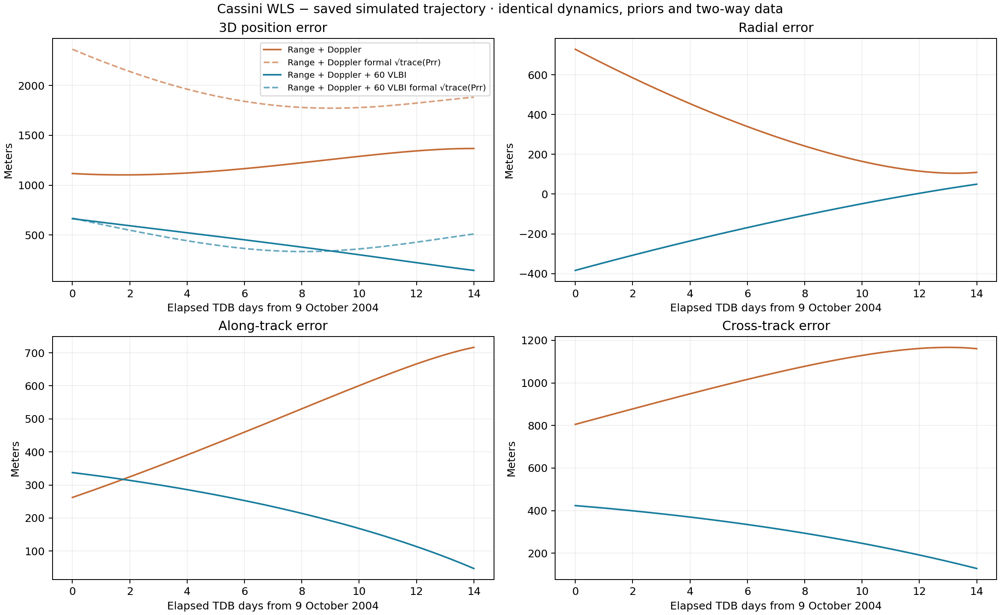
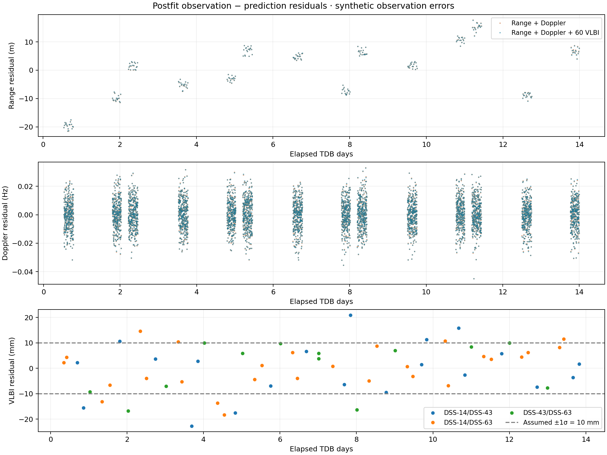
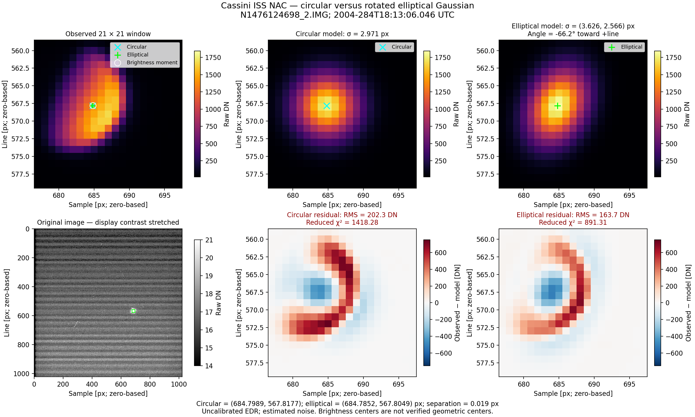

# DeepNAV

Orbit-determination and flight-dynamics tools in C++23: SPICE geometry,
numerical propagation, radiometric observations, WLS/EKF estimation, clock
models, and optical image/geometry utilities.

## Example results

**Cassini two-way WLS:** position errors and postfit residuals for synthetic
range/Doppler observations, comparing solutions with and without 60 VLBI observations.





**Centroid estimation:** circular and elliptical Gaussian fits to the original
Cassini Enceladus image, with brightness centroid and residuals. These are
brightness-center diagnostics on uncalibrated data; the geometric center is not validated.



## Build

Dependencies: **Eigen3** and **CSPICE**, plus CMake 3.20+ and a C++23 compiler.
No graphics libraries or vendored dependencies are required.

```sh
export CSPICE_HOME=/path/to/cspice
cmake --preset apple-clang  # macOS; uses build-clang/
cmake --build build-clang -j4
ctest --test-dir build-clang --output-on-failure
```

For other toolchains, configure with `cmake -S . -B build-clang`.
SPICE-backed tests and mission benchmarks need the local kernels under `Kernels/`.
Legacy Voyager tests also use `kernels.tm`; CTest sets their working directory.

Build the numerical radio/filter subset without CSPICE:

```sh
cmake -S . -B build-numerical -DDEEPNAV_RADIOMETRIC_ONLY=ON -DDEEPNAV_RADIOMETRIC_WITH_CSPICE=OFF
cmake --build build-numerical -j4
ctest --test-dir build-numerical --output-on-failure
```

## Layout

| Folder | Contents |
|---|---|
| `include/`, `src/` | Reusable C++ modules |
| `demos/` | Console examples |
| `scripts/` | Plotting and geometry utilities |
| `tests/` | C++ tests and Python validation |
| `benchmarks/` | Cassini and GMAT experiments |
| `montecarlo/` | EKF Monte Carlo driver and analysis |
| `mission_analysis/` | Scaffold for the future mission-analysis module |
| `docs/` | Model and benchmark documentation |
| `results/` | Local generated results, ignored by Git |

Python tools use NumPy, Pandas and Matplotlib; Cassini geometry plotting also
uses SpiceyPy, Plotly and Kaleido. Run plotters as `python3 scripts/<name>.py`.

## Experiments and models

- [Cassini trajectory](benchmarks/cassini_trajectory/README.md)
- [Cassini two-way WLS](benchmarks/cassini_two_way_wls/README.md)
- [Cassini one-way EKF](benchmarks/cassini_one_way_ekf/README.md)
- [Cassini optical image versus SPICE](benchmarks/cassini_optical_validation/README.md)
- [SPK-driven synthetic optical observations](benchmarks/cassini_synthetic_optical/README.md)
- [GMAT comparison](benchmarks/gmat/README.md)
- [Radiometric models](docs/radiometric.md)
- [Two-way console/EKF demos](docs/cassini_two_way_demo.md)
- [Monte Carlo](docs/monte_carlo.md)
- [Mission analysis scaffold](mission_analysis/README.md)

The Cassini radio benchmarks use synthetic observations and declared model/noise
assumptions. Their errors and formal covariances are experiment results, not
independent flight-navigation accuracy measurements.
