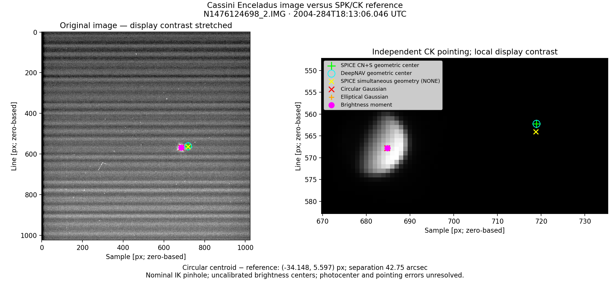

# Cassini optical image versus SPICE reference

This benchmark compares the original full-frame Enceladus exposure
`N1476124698_2.IMG` with the predicted target-center pixel from Cassini SPK/CK
geometry. It checks the production C++ optical geometry against direct CSPICE,
then compares that reference with the existing circular Gaussian, elliptical
Gaussian, and brightness-moment centroids. It does not estimate an orbit.

The [two-image comparison](TWO_IMAGE_COMPARISON.md) adds N1475349073_2 with a
matching reconstructed CK: offsets are 18.70 px (1 October) and 34.60 px
(10 October), so a common fixed pixel shift is not established.

## Run

Requires Eigen, CSPICE, the local image/label under `Input Optical/`, and the
Cassini kernel bundle under `Kernels/Cassini/`. Python requires NumPy and
Matplotlib, and Python 3.11+ for file hashing.

```sh
cmake --preset apple-clang
cmake --build build-clang --target cassini_optical_validation cassini_centroid_demo -j4
python3 scripts/plot_cassini_optical_validation.py
ctest --test-dir build-clang -R test_cassini_optical_spice --output-on-failure
```

The script reruns both C++ executables, rejecting mismatched image identifiers
or exposure times. Options: `--image`, `--kernels`, `--build-dir`, `--output`.
The C++ geometry executable can also run independently with `--help`.

Default outputs in `results/cassini_optical_validation/` (ignored by Git):

- `image_spice_overlay.png`: full-image and local overlays.
- `predictions.csv`: simultaneous geometry (`NONE`), retarded geometry (`CN`),
  apparent geometry (`CN+S`), and DeepNAV predictions at exposure start/mid/end.
- `geometry.json`: calibration, numerical checks, and loaded kernel inventory.
- `residuals.csv`, `comparison.json`: measured-minus-reference pixel residuals,
  angular separations, exposure motion, method spread, limitations, and SHA-256
  hashes of the image, label, and actual loaded kernels.
- `centroid/`: freshly generated image data, fit diagnostics, and window sensitivity.

## Conventions and numerical checks

Use label midpoint **2004-284T18:13:06.046 UTC**, converted to TDB by CSPICE;
exposure duration is **60 ms**. Observer/target states are geometric J2000/SSB
states. DeepNAV solves reception light time and applies its existing approximate
stellar aberration; the independent reference calls CSPICE `CN` and `CN+S`.
Corrections are applied once.

Pointing comes from `J2000` to `CASSINI_ISS_NAC` at each reception time, with
no adjustment using the image. A continuous spacecraft CK interpolation
interval must contain the entire exposure. SPK queries also exercise retarded
target coverage. Missing coverage fails explicitly.

The IK supplies focal length **2003.44 mm**, pixel pitch **0.012 mm**, and
zero-based principal point **(511.5, 511.5)**. Sample/line increase toward
camera **-X/-Y**, as documented in the IK. This is a nominal pinhole model;
no calibrated distortion coefficients are supplied or invented.

The benchmark fails if any exposure sample exceeds these implementation budgets:

| Check | Limit |
|---|---:|
| DeepNAV retarded direction versus CSPICE CN | 1e-10 rad |
| Reception light time versus CSPICE CN | 1e-7 s |
| CameraModel versus explicit IK projection with CSPICE rotation | 1e-9 px |
| DeepNAV apparent projection versus CSPICE CN+S | 0.01 px |

The last budget allows for approximate stellar aberration. These checks validate
implementation consistency, not absolute image-to-ephemeris agreement. The CTest
entry is registered only when the local image and meta-kernel exist at configure time.

## Recorded result

With the existing reconstructed CK and kernel load order, the midpoint reference
is **(718.946901, 562.220467)** pixels.

| Centroid method | Sample | Line | Δsample [px] | Δline [px] | Separation [px] |
|---|---:|---:|---:|---:|---:|
| Circular Gaussian | 684.798919 | 567.817686 | -34.147982 | +5.597220 | 34.603664 |
| Elliptical Gaussian | 684.785187 | 567.804863 | -34.161714 | +5.584396 | 34.615144 |
| Brightness moment | 684.851360 | 567.811283 | -34.095541 | +5.590817 | 34.550878 |

Maximum DeepNAV/CSPICE apparent difference is **0.0000347 px** across the
exposure. The circular centroid differs from the reference by **42.7515 arcsec**.
The centroid-method spread is **0.0665 px**; predicted exposure endpoint motion
is **0.00591 px**.



The geometry implementation passes its checks, but the image does **not** yet
agree with the nominal SPK/CK/camera prediction. Centroid method choice and the
modeled exposure motion are much smaller than the observed discrepancy.

The image is uncalibrated EDR; Gaussian reduced chi-squared is approximately
1418 (circular) and 891 (elliptical), so their formal fit covariances are not a
total uncertainty budget. Brightness centers have no applied photocenter
correction, and the brightest-source association has not been independently
verified. Pointing, calibration, timing conventions, and source association
remain to be investigated. No independent CK pointing covariance is available
in this test, so the residual is not converted into a significance or spacecraft
position error. SPK/CK are reference products, not independently exact truth.
