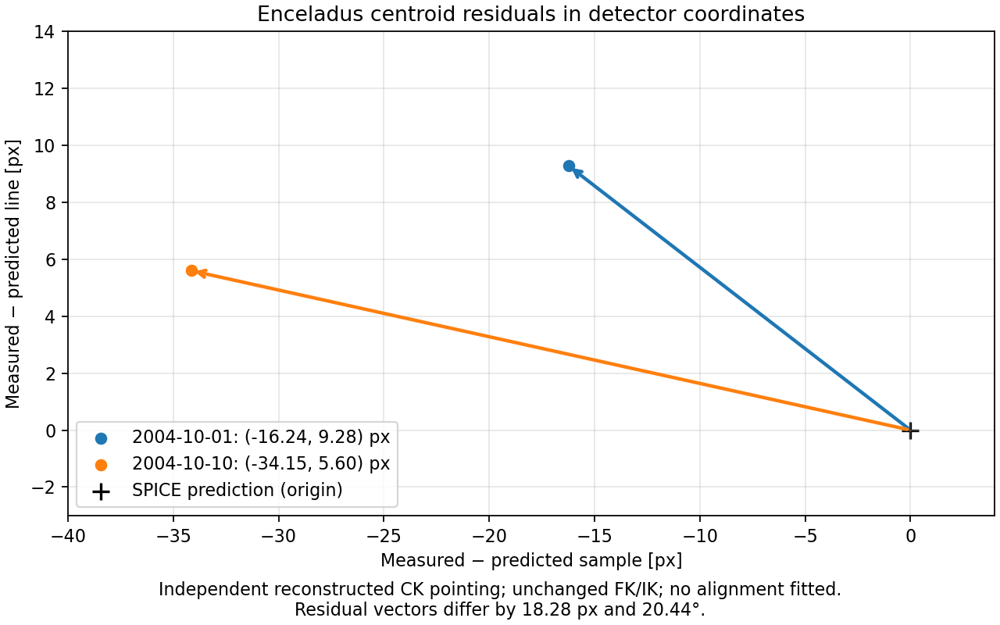
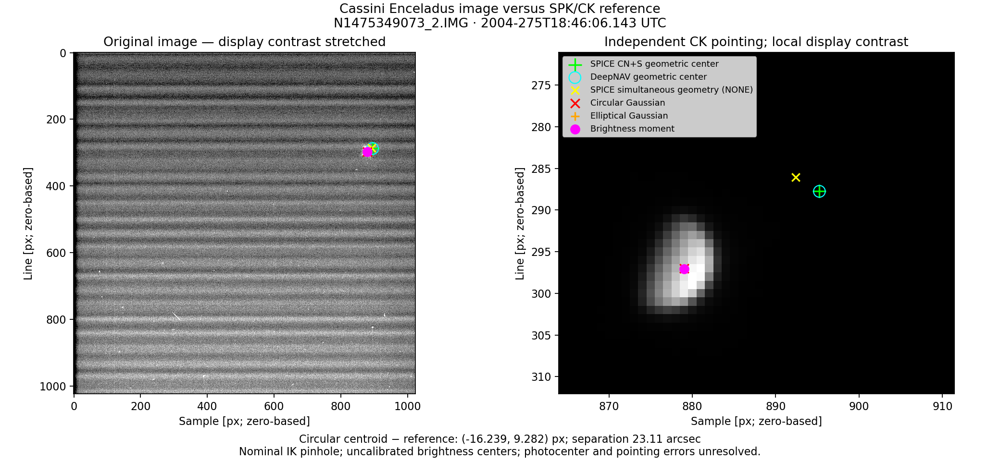

# Two Enceladus exposures: independent SPK/CK comparison

The second exposure is **N1475349073_2**, midpoint **2004-10-01T18:46:06.143 UTC**,
60 ms, full-frame NAC, CL1/CL2, direct 12-bit conversion, with no missing lines
or missing-packet flag. The original binary IMG and detached label were
retrieved directly from PDS. The JPEG preview was not converted into an IMG.

## Inputs and reproduction

Retrieved products:

- [Original IMG](https://planetarydata.jpl.nasa.gov/img/data/cassini/cassini_orbiter/coiss_2007/data/1475293328_1475354049/N1475349073_2.IMG)
- [Original LBL](https://planetarydata.jpl.nasa.gov/img/data/cassini/cassini_orbiter/coiss_2007/data/1475293328_1475354049/N1475349073_2.LBL)
- [Reconstructed CK 04271_04276ra.bc](https://naif.jpl.nasa.gov/pub/naif/CASSINI/kernels/ck/04271_04276ra.bc)
- [CK label](https://naif.jpl.nasa.gov/pub/naif/CASSINI/kernels/ck/04271_04276ra.bc.lbl)

The image and label are under `Input Optical/`. The new CK and label are under
`Kernels/Cassini/ck/`. Both data directories remain ignored by Git. Download
provenance and SHA-256 hashes are recorded locally in
`Input Optical/N1475349073_2.provenance.json` and `Kernels/Cassini/manifest.json`.
Each run also hashes the image, label, and every loaded kernel in `comparison.json`.

The tracked [two-image meta-kernel](two_images.tm) reproduces the original load
order, adding the reconstructed CK for the earlier date. Neither the frame
kernel, instrument kernel, nor original baseline meta-kernel was changed.
The newer exposure continues to use its original reconstructed CK.

From the repository root, after building the executables as described in the
[benchmark README](README.md):

```sh
python3 scripts/plot_cassini_optical_validation.py --image 'Input Optical/N1475349073_2.IMG' --kernels benchmarks/cassini_optical_validation/two_images.tm --output results/cassini_optical_validation/oct01
python3 scripts/plot_cassini_optical_validation.py --image 'Input Optical/N1476124698_2.IMG' --kernels benchmarks/cassini_optical_validation/two_images.tm --output results/cassini_optical_validation/oct10
ctest --test-dir build-clang -R test_cassini_optical_spice --output-on-failure
```

Both runs regenerate centroid fits directly from the original detector data.
No image-based adjustment to the pointing or mounting matrix was made.

## Results

Residuals below are **measured circular brightness centroid minus predicted
apparent target-center pixel**, with zero-based sample and line coordinates.

| Exposure | Predicted sample/line | Measured sample/line | Δsample [px] | Δline [px] | Norm [px] | Angular separation |
|---|---|---|---:|---:|---:|---:|
| 1 October, N1475349073_2 | 895.239455 / 287.754615 | 879.000360 / 297.036315 | -16.239095 | +9.281699 | 18.704495 | 23.1086 arcsec |
| 10 October, N1476124698_2 | 718.946901 / 562.220467 | 684.798919 / 567.817686 | -34.147982 | +5.597220 | 34.603664 | 42.7515 arcsec |



The vectors share their sample/line signs, but differ by **18.283972 px** and
**20.44 degrees** in direction. Their magnitudes differ by a factor of about 1.85.
A single constant detector-pixel translation cannot reconcile both observations.

For the new exposure, DeepNAV's apparent projection differs from direct CSPICE
CN+S by at most **0.0000351 px**. The centroid-method spread is **0.0513 px**;
predicted exposure endpoint motion is **0.00836 px**. Circular and elliptical
Gaussian reduced chi-squared are approximately **961** and **547**, respectively.
These fits remain brightness-center diagnostics, not calibrated geometric-center
measurements with a complete uncertainty budget.

The new CK has a continuous interpolation interval containing the exposure from
**2004-10-01T09:02:07.513** to **2004-10-01T23:59:59.162 UTC**. Direct `ckgp`
with zero tolerance returns exactly the requested encoded clock ticks at the
midpoint. Both geometry runs pass the benchmark's numerical checks, including
full-exposure CK coverage and retarded-epoch SPK queries.



## Interpretation

The second image also shows a substantial discrepancy, while timing-scale
exposure motion and the choice among the three centroid methods are much smaller.
However, the discrepancy is not a repeat of the same fixed pixel offset.

A mounting rotation remains a candidate, as do epoch-dependent attitude errors,
camera calibration, and source/photocenter effects. A fixed three-dimensional
rotation is not identical to a fixed pixel translation across the field, so
this comparison alone neither establishes nor excludes a mounting-matrix error.
The next discriminating measurement is independent star-field pointing for
these exposures, retaining uncertainty in camera calibration and photocenter.
