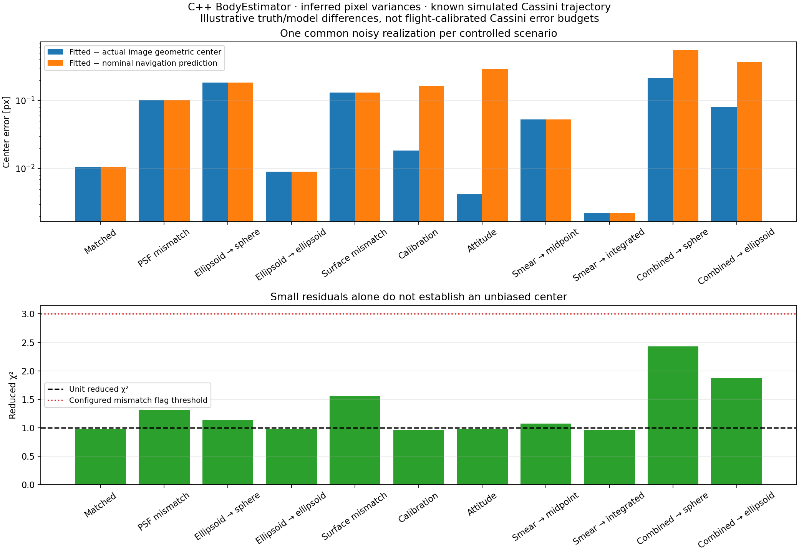
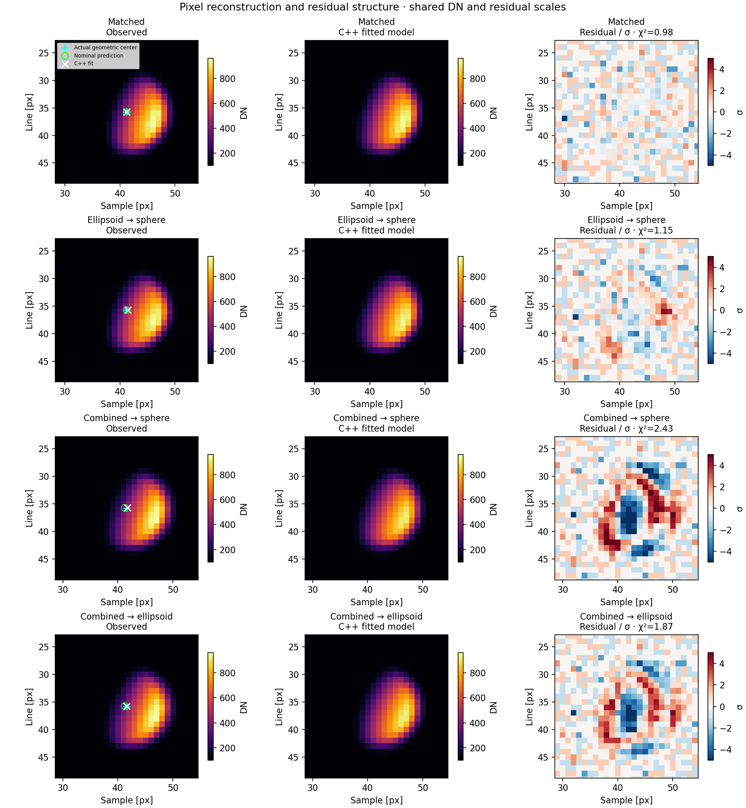
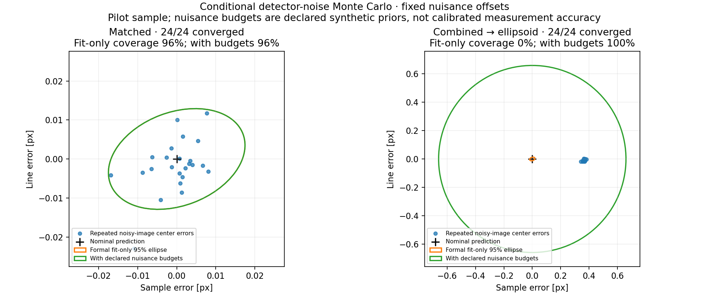

# C++ illuminated-body estimation and realism experiment

The follow-up [phase/size/signal and shared-nuisance validation](VALIDATION_SWEEP.md)
extends this fixed-scene pilot across multiple conditions and dates.

The numerical image fit now runs in C++. Python only plots the exported results.
The observable is the **fitted geometric center and its 2×2 covariance**. No EKF
update is introduced here.

## API and data flow

```cpp
using namespace fd::opnav;

CameraCalibration calibration;
calibration.intrinsics = nominalIntrinsics;
calibration.psfSigmaPixels = 0.8;
calibration.electronsPerDn = 10;
calibration.readNoiseElectrons = 3;
calibration.biasDn = 100;

BodyModel body;                 // Default ENCELADUS, unit sphere.
BodyFitOptions options;
BodyEstimator estimator(BodyRenderer(body), calibration, options);

OpticalImage image;
image.body = "ENCELADUS";
image.time = receptionEpoch;    // TDB seconds past J2000, exposure midpoint.
image.attitude = nominalAttitude;
image.exposureSeconds = 0.06;
image.dn = observedDn;
image.mask = badPixelMask;      // Empty means no additional mask.
auto result = estimator.fit(image); // Optional second argument: BodyParameters guess.

if (result.passesFitChecks()) {
    auto centerAndCovariance = *result.measurement;
    // Retain result.body/time and the recorded attitude for navigation prediction.
}
```

- [BodyEstimator.hpp](../../include/opnav/estimation/BodyEstimator.hpp) defines
  `OpticalImage`, calibration/options, renderer, parameters and result types.
- [BodyRenderer.cpp](../../src/opnav/estimation/BodyRenderer.cpp) integrates
  Lambert radiance over a projected sphere or ellipsoid, convolves with a Gaussian
  analytically integrated over detector pixels, and supplies analytic derivatives.
- [BodyEstimator.cpp](../../src/opnav/estimation/BodyEstimator.cpp) selects a
  fitting window, initializes from observed moments, tries two illumination
  directions, and solves a bounded seven-parameter weighted least-squares fit.
- [SpiceBodyModel.hpp](../../include/opnav/estimation/SpiceBodyModel.hpp) exposes
  `makeSpiceBodyModel(body, nominalEmissionEpoch, nominalAttitude, intrinsics)`.
  It registers PCK radii and body orientation without querying an observer state.

The seven fitted quantities are sample/line center, angular size expressed as a
pixel radius, phase, image-plane Sun angle, radiance amplitude and background.
PSF width and body axis ratios are fixed nominal calibration/model inputs.
The numerical library `deepnav_optical_image` requires Eigen, but **no CSPICE**.
The optional geometry factory belongs to `deepnav_optical_synth`.

For an ellipsoid, configure `BodyRenderer(makeSpiceBodyModel(...))`. A reusable
estimator can receive an updated nominal `image.bodyToView` for each exposure;
axis ratios remain registered in the renderer. The upstream geometry layer
computes the emission epoch using reception time and a nominal light-time solution.
The fitter checks the body ID and carries the timestamp through the result; it
does not silently fetch Cassini SPK truth or regenerate pointing from its state.

For known motion, set `image.smearPixels` to the nominal end-minus-start image
displacement and `options.exposureSamples > 1`. The fitting renderer integrates a
linear translation of a fixed scene. It does not reproduce arbitrary changing
illumination, perspective, or angular acceleration. The default single sample
is a midpoint approximation, tested explicitly below.

## Truth/model differences

The existing generator API remains `create(body, time, noise, observer)`, with
either an SPK observer name or an injected simulated `StateProvider`. Its options
now also support PCK triaxial ellipsoids, body-fixed smooth albedo structure,
Lambert/Lommel–Seeliger mixing, elliptical detector-aligned Gaussian blur,
distorted camera rays, and optional range/exposure count scaling. Arbitrary
time-dependent truth attitudes permit offsets, jitter and exposure scans.

| Effect | Synthetic truth in this experiment | Fitting model |
|---|---|---|
| Detector | Poisson photons, 3 e− read noise, 10 e−/DN, rounding | Variances inferred from DN and nominal detector calibration |
| PSF | Sample/line sigma 0.88/0.72 px | Circular Gaussian, sigma 0.8 px |
| Shape | PCK triaxial Enceladus radii | Sphere, then nominal PCK ellipsoid |
| Surface | 12% body-fixed albedo modulation; 15% Lommel–Seeliger mixture | Uniform Lambert surface |
| Calibration | Focal scale +0.04%; principal point (+0.12, −0.08) px; radial distortion | Nominal pinhole; declared calibration covariance |
| Attitude | Static (+0.25, +0.15) px-equivalent shift; 0.08 px sinusoidal jitter | Recorded nominal rotation; declared 0.25 px-equivalent pointing sigma |
| Exposure | Geometry and attitude sampled through 4 s | Midpoint versus nine-sample linear-smear integration |

These are **illustrative synthetic perturbations**, not measured Cassini error
budgets. The radial coefficient is K1=50000 in normalized camera coordinates;
its numerical magnitude alone is not a pixel displacement. The nominal fitter
currently supports square pixels without shear and a Gaussian PSF, not a general
calibrated distortion/PSF inversion. Truth uses inverse camera distortion to
trace rays. Noise generation is shared through `synth::sampleDetector`, allowing
new detector realizations without rerendering the geometry.

Default pixel variance is
`max(DN-bias,0)/gain + (readNoise/gain)^2 + 1/12` for digitized images.
Set `inferVarianceFromDn=false` to use supplied `image.varianceDn2` instead.
Masked, saturated and nonfinite observations are excluded. Truth variance and
true geometric centers are never passed into the realism fits.

## Experiment and results

The benchmark uses Enceladus at **2004-10-10 00:00:00 UTC**, the retained
`multibody_j2_srp_thermal` simulated spacecraft trajectory used by the radio
example, and SPK target/Sun ephemerides. It renders a 64×64 field with eightfold
subpixel sampling. The target is deliberately off-axis to reveal calibration
effects. Optical pointing is synthetic, rather than Cassini CK camera pointing.
CKs loaded by `SavedSimulation` support its force/interpolation model.

The reference trajectory also defines the nominal motion and comparison pixel
in this controlled experiment: it isolates imaging effects rather than testing
orbit recovery. In an EKF, those predictions must instead use the estimated
trajectory, with recorded camera pointing held fixed. Long-exposure comparisons
hold the photon budget equal to the short exposure to isolate smear at equal
signal-to-noise; they are **not a fixed-photon-rate exposure experiment**.

Extraction error means fitted center minus the actual geometric center in the
rendered image. Navigation discrepancy means fitted center minus the pixel
predicted with nominal attitude/calibration. Calibration and pointing errors
can produce a large navigation discrepancy despite good extraction.

| Controlled case | Extraction error [px] | Navigation discrepancy [px] | Reduced χ² |
|---|---:|---:|---:|
| Matched sphere | 0.0106 | 0.0106 | 0.978 |
| PSF mismatch | 0.1028 | 0.1028 | 1.310 |
| Ellipsoid → sphere | 0.1841 | 0.1841 | 1.146 |
| Ellipsoid → ellipsoid | 0.0091 | 0.0091 | 0.978 |
| Surface mismatch | 0.1319 | 0.1319 | 1.558 |
| Calibration mismatch | 0.0185 | 0.1633 | 0.967 |
| Attitude mismatch | 0.0042 | 0.2956 | 0.979 |
| Exposure → midpoint | 0.0531 | 0.0531 | 1.073 |
| Exposure → integrated | 0.0022 | 0.0022 | 0.970 |
| Combined → sphere | 0.2143 | 0.5512 | 2.430 |
| Combined → ellipsoid | 0.0806 | 0.3652 | 1.868 |

One common noisy realization per controlled case; these are not ensemble RMS
values. All pass the configured convergence/χ² checks, including biased cases.





A separate **24-trial detector-noise pilot per model** gives 24/24 converged
fits in both cases. Extraction RMS is **0.00911 px** for the matched model and
**0.08368 px** for the combined ellipsoid model. The latter has mean extraction
error (−0.01275, −0.08217) px and mean navigation discrepancy
(+0.36377, −0.00890) px.

The formal covariance marginalizes the other five fitted parameters through the
full local information matrix; it is not multiplied by reduced χ². The returned
measurement covariance additionally propagates declared independent principal
point, focal-scale and small-angle pointing uncertainties, plus an optional
explicit center-model allowance. These additions describe navigation-prediction
uncertainty, rather than detector extraction noise alone.

Formal 95% navigation-error coverage is 23/24 for the matched model and 0/24 for
the combined model. Adding the declared nuisance budgets covers 24/24 combined
trials. **This does not validate those budgets:** nuisance offsets were fixed,
and only detector noise varied. Unknown surface/PSF bias and correlations between
images remain unvalidated. Persistent alignment/calibration errors must be
handled as shared nuisance parameters or correlated errors in a future EKF;
reusing an independent covariance per image does not capture them.



## Reproduce

Requires the local kernels and saved radio truth trajectory. No new C++ libraries
or Python fitting dependencies are introduced; plotting uses NumPy/Matplotlib.

```sh
cmake --preset apple-clang
cmake --build build-clang --target cassini_optical_realism test_body_estimator test_synthetic_optical -j4
./build-clang/cassini_optical_realism --trials 24
python3 scripts/plot_optical_realism.py
ctest --test-dir build-clang -R '^test_(body_estimator|synthetic_optical)$' --output-on-failure
```

Outputs: `results/cassini_synthetic_optical/realism/` contains case/trial CSVs,
pixel arrays, configuration, the three plots, and `metrics.json` with input hashes.
The executable accepts `--output DIR`; the plotter accepts that directory as a
positional argument. Tests cover analytic derivatives including integrated
ellipsoids, center recovery, nuisance covariance propagation, inverse distortion,
invalid data, and the earlier independent ray-traced fixture when available.
