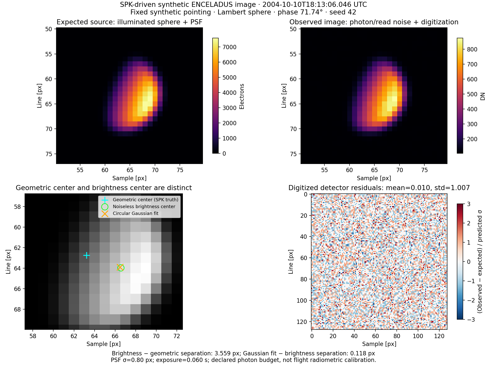
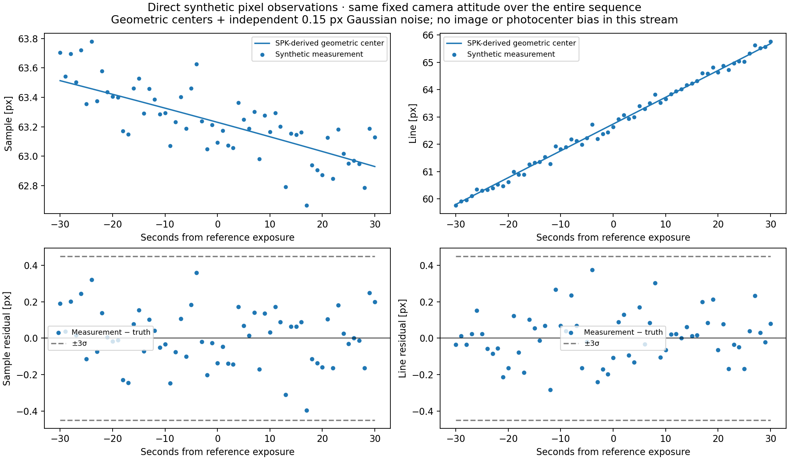
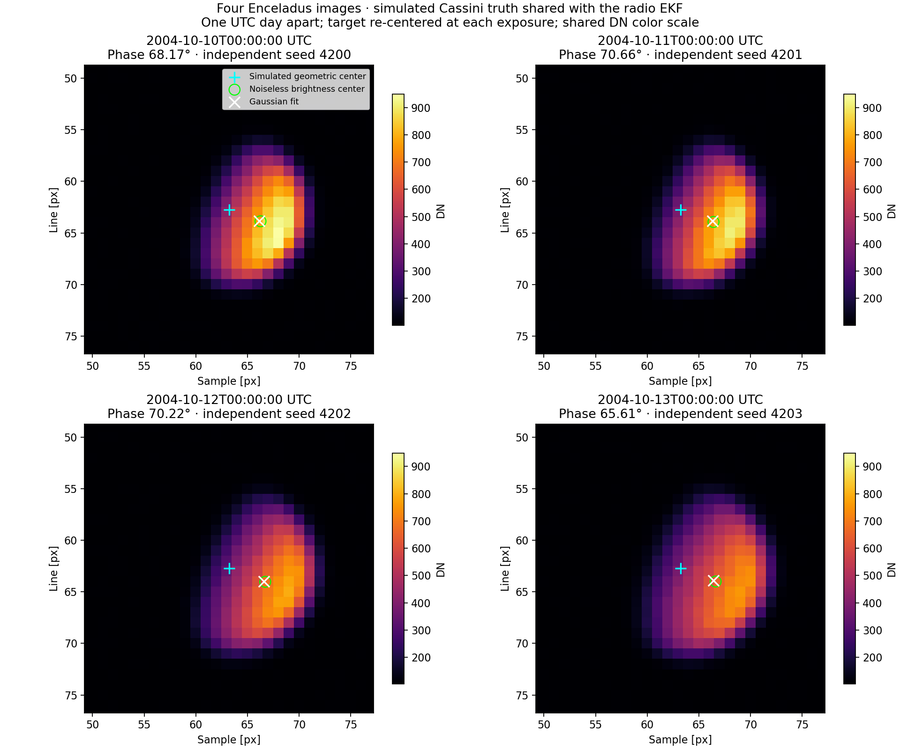
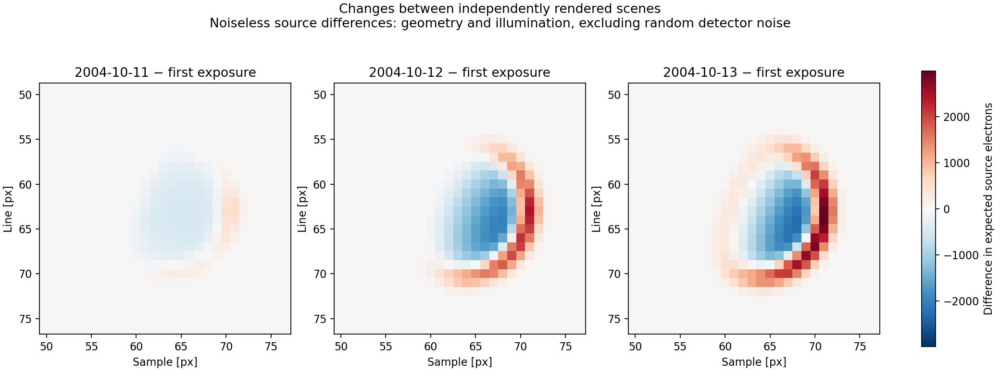
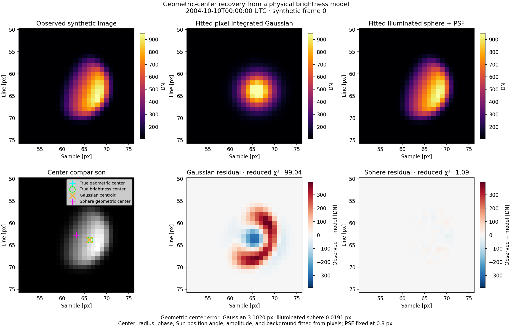

# SPK-driven synthetic optical observations

The current [C++ body estimator and realism experiment](CPP_ESTIMATION.md)
extends this baseline with ellipsoids, albedo/reflectance differences, elliptical
PSF, calibration/pointing perturbations, and exposure comparisons. It returns
fitted geometric centers and covariances; Python produces the diagnostic plots.

Reusable API: [SyntheticImageGenerator](../../include/opnav/synth/SyntheticImageGenerator.hpp).
The caller loads kernels, configures a camera and an independent truth attitude,
then requests a direct pixel measurement or a rendered image:

```cpp
using namespace fd::opnav;
using namespace fd::opnav::synth;

SyntheticImageOptions options;
options.size = {128, 128};
options.exposureSeconds = 0.06;
options.psfSigmaPixels = 0.8;
options.fullPhaseElectrons = 1e6;

// camera and fixedTruthAttitude are configured once, outside observation calls.
SyntheticImageGenerator synthImage(camera,
    [fixedTruthAttitude](TdbEpoch) { return fixedTruthAttitude; }, options);

OpticalDetectorNoise noise;
noise.electronsPerDn = 10;
noise.backgroundElectrons = 50;
noise.biasDn = 100;
noise.seed = 42;

auto frame = synthImage.create("ENCELADUS", TdbEpoch{tdbSeconds}, noise, "CASSINI");
auto pixel = synthImage.createMeasurement("ENCELADUS", TdbEpoch{tdbSeconds},
    OpticalPixelNoise{0.15, 1001}, "CASSINI");
```

`create` aliases `createImage`. Link `deepnav_optical_synth` in CMake.
Use a distinct seed for each independent exposure; repeating a seed intentionally
repeats the random stream within the same toolchain. TDB is seconds past J2000,
not UTC text or a Julian date. SPICE failures propagate explicitly.

## Geometry and rendering

Observer/target states come from SPK in geometric J2000/SSB coordinates. The
existing DeepNAV reception light-time and approximate stellar-aberration model
produces the target direction; its center is compared independently with CSPICE
`CN+S` in the demo. The supplied attitude rotates that direction into the camera.
It must remain independent of the estimated spacecraft state.

`createMeasurement` returns the geometric-center pixel plus independent sample/
line Gaussian noise and its 2x2 covariance. The center must be inside the detector.
This stream is a midpoint observation and deliberately has no photocenter bias.

By default, `createImage` traces subpixel rays through a sphere with Lambertian illumination.
The sphere radius is explicit, or defaults to the mean of the target's three PCK
radii. Sun geometry is evaluated at target emission time; an optional camera-frame
illumination direction supports controlled phase tests. The distant-body model
requires radius/range < 0.01. Solar light-time, terrain, stars,
mutual occultations, and calibrated surface reflectance are not included.

Uniform-shutter midpoint quadrature evaluates geometry and attitude across the
exposure. A unit-sum Gaussian PSF is convolved on the oversampled grid before
integration into detector pixels. Padding admits source light blurring into the
frame, while detector cropping loses flux without renormalization.

`fullPhaseElectrons` is a declared total count for this exposure at midpoint
range and full illumination, not a flight-calibrated brightness prediction.
The normalization uses the local projected area and the full-phase Lambert disk
integral; actual counts vary with phase and exposure geometry. Changing exposure
duration alone does not change this declared count budget: change both when
modeling a fixed physical photon rate.

The renderer now accepts invertible camera distortion through `CameraModel::unproject`;
the default remains pinhole `NoDistortion`. Full-resolution mission-calibrated
camera simulation is not claimed by this baseline. The optional
`referenceRangeKm`/`referenceExposureSeconds` settings enable physical relative
range/exposure scaling of the declared photon budget.

## Noise and truth separation

Photon noise is Poisson in source plus background electrons; Gaussian read noise
is added before gain conversion, bias, optional integer digitization, and clipping.
Background includes any declared sky/dark electron budget; electronic bias is
not subjected to photon noise. Clipped pixels are masked.

`varianceDn2` is the pre-clipping Poisson/read variance, with an approximate
1/12 DN² digitization contribution when rounding is enabled. Digitized residuals
are discrete and need not be Gaussian. Disable shot noise, read noise, and
quantization for a deterministic detector; its modeled variance is then zero.

Each frame keeps expected source electrons and separate truth metadata:
midpoint geometric center, noiseless brightness center after PSF/cropping,
midpoint observer state, attitude, phase, radius, range, light time, and seed.
Pass only `dn`, `varianceDn2`, and `mask` to centroid extraction. Truth is for
evaluation; a Gaussian fitted to an illuminated disk is a mismatched model.

## Run and plot

Requires Eigen, CSPICE, and the local Cassini SPK/planetary kernels. The demo's
[meta-kernel](kernels.tm) contains no CK, SCLK, FK, or IK. Camera scale is explicitly
2003.44 mm / 0.012 mm, on a synthetic 128x128 detector. Pointing is initialized
once toward Enceladus at 2004-10-10T18:13:06.046 UTC and held fixed for the sequence.

```sh
cmake --preset apple-clang
cmake --build build-clang --target cassini_synthetic_optical test_synthetic_optical -j4
./build-clang/cassini_synthetic_optical
python3 scripts/plot_synthetic_optical.py
ctest --test-dir build-clang -R test_synthetic_optical --output-on-failure
```

Python 3.11+, NumPy, and Matplotlib are required. Outputs are under
`results/cassini_synthetic_optical/`: `frame.csv`, `measurements.csv`, `summary.json`,
`plot_diagnostics.json` (including kernel hashes), `synthetic_frame.png`, and
`synthetic_measurements.png`. Both executable and plotter accept an alternative
output directory (`--output DIR` for C++; positional directory for Python).

## Recorded example

- Geometry versus CSPICE: **0.0000347 px**.
- Illumination phase: **71.74 degrees**; noiseless brightness-center offset:
  **3.559 px** from the geometric center.
- Circular Gaussian fit versus noiseless brightness center: **0.118 px**.
  Reduced chi-squared is about **219**: this fit is not a validated geometric-center
  measurement, despite the completely known synthetic scene.
- 61 direct geometric-center observations over 60 seconds, with declared 0.15 px
  noise: sample/line residual RMS **0.155 / 0.136 px** for the recorded seeds.
- Normalized detector residual standard deviation: **1.007**.





Automated tests check the full-phase flux and symmetry, analytic Lambert
quarter-phase law, PSF flux conservation, crop losses, exposure smear, seed
reproducibility, saturation masks, photon/read and direct-pixel noise statistics,
zero-noise measurements, invalid inputs, and missing SPK coverage. The test skips
with code 77 when the required local Cassini SPK is unavailable.

## Four images using the EKF's simulated Cassini truth

The generator also accepts a `dynamics::StateProvider` instead of a SPICE observer
name. This is the interface to use with simulated observations:

```cpp
auto frame = synthImage.create("ENCELADUS", epoch, detectorNoise, simulatedTruth);
auto pixel = synthImage.createMeasurement("ENCELADUS", epoch, pixelNoise, simulatedTruth);
```

The provider supplies **geometric J2000/SSB position and velocity**, including every
exposure integration sample. Providers declaring a different frame/origin are
rejected. A Saturn-relative simulation must add Saturn's barycentric position
and velocity; the existing `SavedSimulation` provider already does that.
Enceladus and the Sun remain SPK ephemerides, with the same kernel choices as the
radio experiment. No estimated spacecraft state is used to generate observations.

The four-image executable uses the exact retained `SavedSimulation` provider,
model selection, and force parameters used by `cassini_one_way_ekf`, reading
`results/cassini_two_way_wls/pass_schedule/truth/trajectory.csv`. It selects
`multibody_j2_srp_thermal`, not the SPK comparison rows in that CSV. It is not a
new independent integration or a fitted trajectory. The saved truth must exist.

Dates: **10, 11, 12, and 13 October 2004, at 00:00:00 UTC**. This spans three days,
with one day between images. Each exposure is **60 ms**. For each scheduled
exposure, a synthetic camera attitude is declared from the truth bearing and
then held fixed through the exposure. The exported rotations must also be held
fixed during future EKF prediction and Jacobian calculations; re-aiming from the
estimated state would remove the angular position information.

The retained simulation needs CK attitude for SRP/thermal interpolation derivatives;
these force-model kernels do **not** supply the synthetic optical camera attitude.
The image-generator observer is the simulation provider, not a Cassini SPK query.
A regression test injects a 100 km spacecraft displacement to verify that both
image truth and pixel observations change with the supplied simulated state.

```sh
cmake --build build-clang --target cassini_synthetic_sequence -j4
./build-clang/cassini_synthetic_sequence
python3 scripts/plot_synthetic_optical_sequence.py
```

Outputs in `results/cassini_synthetic_optical/simulated_sequence/`:

- `frame_0.csv` through `frame_3.csv`: rendered detector images and variances.
- `observations.csv`: four **direct geometric-center** observations with 0.15 px
  Gaussian noise, full 2x2 covariance entries, TDB epochs, target identity, and
  frozen inertial-to-camera rotations. These are the idealized EKF baseline input.
- `truth.csv`: evaluation-only states in both J2000/SSB and Saturn-relative J2000.
- `summary.json`: image-derived Gaussian centroids/covariances, brightness and
  geometric truth, phase, seeds, trajectory source, and kernel inventory.
- `simulated_sequence.png`, `direct_observations.png`, `diagnostics.json`: Python
  plots and input hashes, including the retained trajectory.

Image-derived Gaussian centroids remain diagnostic: a geometric-center EKF model
must account for photocenter/model bias and realistic covariance before using
them. Four images are a sparse demonstration schedule, not a guarantee of full
orbit observability; combine them with the radio observations/prior when building
the EKF example. No EKF update has been added by this image-generation step.



### Similar appearance and the centroid offset

The four scenes are rendered independently. They look similar because the camera
is re-centered at each exposure, the surface is a uniform sphere without terrain
or albedo features, and phase varies only from 65.61 to 70.66 degrees. The sequence
also assigns the same full-phase photon count to each exposure rather than a
single physical albedo with an inverse-square brightness law across dates.

The plot now uses one shared DN scale; earlier per-panel autoscaling concealed
brightness changes. Peak observed DN drops from 949 to 755 between the first and
last frame. The expected-source relative L2 differences from the first frame are
7.3%, 27.8%, and 32.7% for the following frames; these differences exclude noise.

| UTC date | Phase [deg] | Brightness minus geometric center norm [px] | Gaussian fit minus brightness center norm [px] |
|---|---:|---:|---:|
| 10 October | 68.17 | 3.236 | 0.142 |
| 11 October | 70.66 | 3.408 | 0.126 |
| 12 October | 70.22 | 3.722 | 0.157 |
| 13 October | 65.61 | 3.622 | 0.230 |

Most of the offset exists in the noiseless rendered source before centroid
extraction: its illuminated side shifts the brightness center toward the Sun.
The smaller additional discrepancy is from fitting a Gaussian to a non-Gaussian
illuminated disk, plus detector noise. Reduced fit chi-squared is 214–233, so the
formal Gaussian-fit covariance is not an adequate total uncertainty model.



## Recovering the geometric center with an illuminated-body fit

[fit_synthetic_body.py](../../scripts/fit_synthetic_body.py) compares a fitted
pixel-integrated Gaussian with a fitted illuminated Lambert sphere on the first
synthetic frame (10 October). Both use the same 37x37 window, masks, and supplied
noise variances. This is a Python fitting example, not an EKF update or terrain
reconstruction.

The sphere fits seven parameters: geometric sample/line, apparent radius, phase,
Sun position angle in the image, radiance amplitude, and background. Only the
0.8 px Gaussian PSF width is fixed as a declared calibration input. Initial
values come from pixel moments and two illumination-direction starting points.
The true geometric/brightness centers and illumination are read only after
fitting, for evaluation and plotting; noiseless source pixels and spacecraft
states are not used in the objective or initialization.

The forward model integrates Lambert radiance over a fixed unit-disk quadrature
and analytically integrates the Gaussian PSF over each detector pixel. This
avoids moving hard raster boundaries in the optimizer's center/size derivatives.
The approximation is a distant projected sphere; exposure motion is negligible
for this 60 ms example and is not fitted.

```sh
python3 scripts/fit_synthetic_body.py
# Optional numerical-resolution check, retaining the default result:
python3 scripts/fit_synthetic_body.py --quadrature-order 48 --output results/cassini_synthetic_optical/simulated_sequence/body_fit_0/check_order48
```

Requires SciPy in addition to the plotting dependencies. Options include
`--frame`, `--psf-sigma`, `--quadrature-order`, an input directory, and `--output`.
The default output is `body_fit_0/` inside the simulated-sequence results folder,
containing `comparison.json`, `fit_arrays.npz`, and `body_fit_comparison.png`.

| Model | Geometric-center error in this noisy image | Reduced chi-squared |
|---|---:|---:|
| Circular Gaussian | 3.1020 px | 99.04 |
| Illuminated sphere + PSF | 0.0191 px | 1.09 |

Truth center: **(63.230000, 62.740000)**. Recovered sphere center:
**(63.211405, 62.735747)**. Fitted phase: **68.526 degrees**, versus generated
**68.174 degrees**. Doubling the quadrature order changes the fitted center by
**0.000337 px**, with geometric-center error **0.01874 px**.

The JSON also exports the local linearized center covariance. It excludes
shape, albedo, PSF-calibration, and other model errors; those need testing before
using this covariance in an EKF. A single noisy realization demonstrates center
recovery under the assumed model, not a Monte Carlo bias or flight accuracy.
The synthetic source is itself a uniform Lambert sphere with the specified PSF;
this is intentionally a favorable model-consistency experiment.


