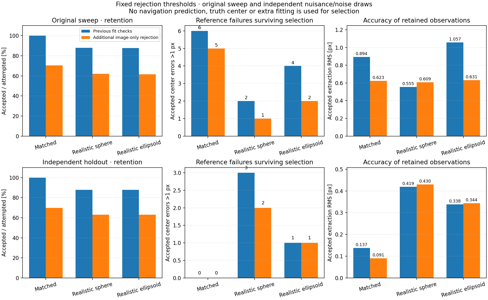
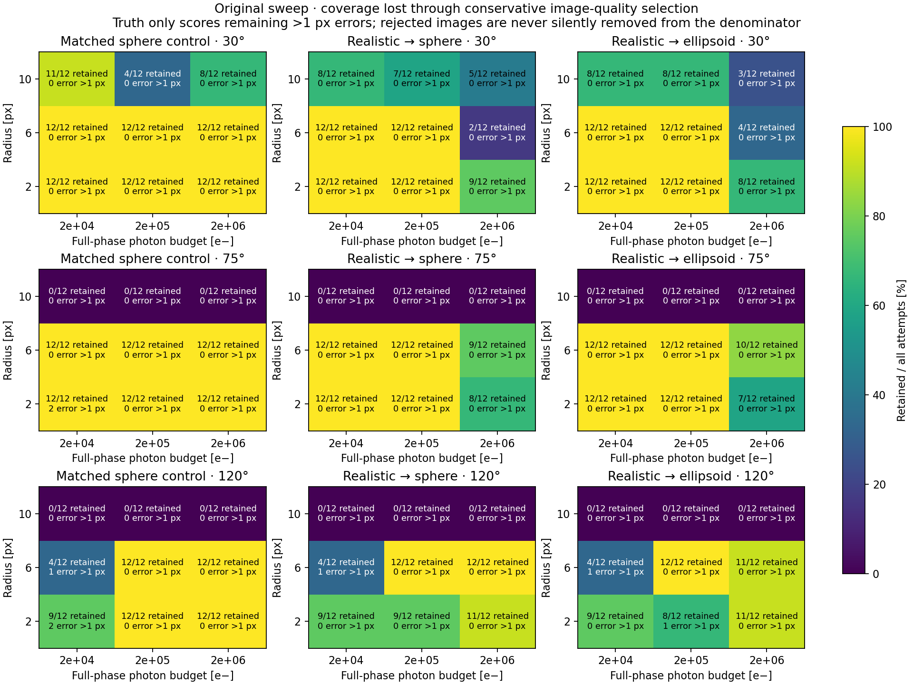
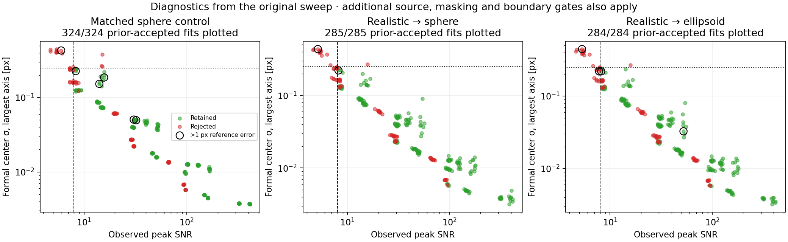

# Optical fit rejection

[EstimatorRejection.hpp](../../include/opnav/estimation/EstimatorRejection.hpp)
and [EstimatorRejection.cpp](../../src/opnav/estimation/EstimatorRejection.cpp)
provide a separate, stateless quality layer. The body fitter API is unchanged.
The decision contains rejection reasons, numerical diagnostics and a per-check
state (`NotRun`, `Passed`, `Failed`). Acceptance means the configured checks pass;
it is not a certificate of unbiased or independently distributed measurements.

```cpp
using namespace fd::opnav;
BodyRenderer renderer(bodyModel);
BodyEstimator estimator(renderer, calibration, fitOptions);
auto fit = estimator.fit(image, initialGuess);

EstimatorRejection rejection;
RejectionContext context;
context.calibration = &calibration;
context.renderer = &renderer;
context.exposureSamples = fitOptions.exposureSamples;
auto decision = rejection.evaluate(image, fit, context);

if (decision.accepted()) {
    // fit.measurement is unchanged. Retain its body, epoch and recorded attitude.
}
for (auto reason : decision.reasons) {
    std::cout << rejectionReasonName(reason) << '\n';
}
```

The context must use the same registered nominal shape, PSF, saturation level
and exposure approximation as the fit. No truth center, source image, observer
truth state, or true detector variance is an input to rejection.

## Default image checks

| Check | Initial conservative threshold |
|---|---|
| Valid fit | Converged measurement; matching body/time; finite, consistent arrays |
| Covariance | Positive-definite formal and measurement center covariance |
| Residuals | Reduced χ² ≤3 and no fitter model-mismatch flag |
| Peak SNR | At least 8 above the fitted background in the body aperture |
| Source SNR | At least 25 using the fitted source template and observed pixels |
| Usable pixels | At least 30 in the fitting window |
| Masking/saturation | At most 10% unusable pixels in the body/PSF aperture |
| Boundary | Full conservative body radius + 3 PSF sigma, plus 1 px margin, inside both image and fit window |
| Formal center uncertainty | Largest one-sigma axis ≤0.25 px |
| Measurement uncertainty | Largest one-sigma axis ≤1 px, including declared nuisance budgets |

For ellipsoids the maximum registered axis bounds the support conservatively.
An integrated fit also includes half the nominal smear displacement. This
boundary criterion intentionally rejects some otherwise accurate cropped fits.
The fitted-template source statistic is
`sum(s_i * (DN_i-background)/v_i) / sqrt(sum(s_i^2/v_i))`, with
`s_i=max(model_i-background,0)` on valid pixels. Both SNR diagnostics depend on
the fitted model/background; they are quality proxies, not independent detection
probabilities or guarantees that the geometric center is identifiable.

Thresholds are explicit `RejectionOptions`. Required camera/shape inputs cannot
silently disappear: missing data rejects the image. Invalid configuration throws;
invalid fit/context data returns a rejected decision. The layer never modifies a
fit, inflates its covariance or launches additional fitting.

## Optional ambiguity and navigation checks

The caller may supply `context.alternatives`, a span of independently initialized
fits. The layer renders each converged candidate on the **same valid pixels and
variance weights** as the selected fit. An alternative more than 0.25 px away
with total χ² no worse than selected χ² +9 rejects the selected solution. Better
alternatives also trigger rejection. Their own fitting-window χ² values are not
used for comparison.

The caller may supply a `NavigationPrediction` with matching body/time, predicted
center and pixel covariance. The innovation gate uses
`S = R + P - C - C.transpose()` and rejects `innovationᵀ S⁻¹ innovation >13.81551`
(the nominal 99.9% boundary for a 2D Gaussian). `C` is the supplied
measurement/prediction error cross covariance and defaults to zero. The joint
covariance must be positive semidefinite and S positive definite. Shared attitude
or calibration uncertainty must only be counted once; this API does not infer
which budgets the caller has already included.

Set `requireAmbiguityCheck` or `requireNavigationCheck` to reject when the
corresponding inputs/check are unavailable. Otherwise unavailable optional
checks remain visibly `NotRun`. A no-context call with the default image gates
rejects because calibration and registered shape are required.

## Reproduction and scope

```sh
cmake --build build-clang --target cassini_optical_validation_sweep test_estimator_rejection -j4
ctest --test-dir build-clang -R '^test_(estimator_rejection|body_estimator|synthetic_optical)$' --output-on-failure

# Original sweep: identical images and fits, additional decisions in a new folder.
./build-clang/cassini_optical_validation_sweep --draws 12 --tracks 24 --output results/cassini_synthetic_optical/validation_rejection

# Independent nuisance AND detector draws; identical frozen rejection thresholds.
./build-clang/cassini_optical_validation_sweep --draws 6 --tracks 12 --seed 20261018 --output results/cassini_synthetic_optical/validation_rejection_holdout

python3 scripts/plot_optical_rejection.py --holdout results/cassini_synthetic_optical/validation_rejection_holdout
```

These experiments exercise **image-only rejection**. Navigation and alternative
fits are deliberately absent: the original sweep's navigation reference has an
exact observer trajectory and would give an unfair oracle gate. Their absence is
recorded, not represented as a passed check. Unit tests exercise the optional
gates, including common-window comparisons, missing required checks, covariance
cross terms, stale predictions, and impossible joint covariances.

The original sweep has 744 observation images / 1,164 fitting attempts; the
independent holdout has 372 images / 582 attempts. The held-out seed changes both
detector and nuisance draws. Thresholds are unchanged between runs and were not
optimized against error labels. The >1 px reference failure definition comes
from the earlier sweep; it is used only to score rejection, not to select images.

`rejections.csv` records decisions, all reasons and quality metrics alongside
the unchanged `observations.csv`. `rejection_options.json` records the preset.
The plotter verifies original-fit agreement and reports retention, remaining
previously accepted failures, rejected observations with ≤1 px error, post-gate
accuracy/covariance coverage, and reason counts (which can overlap).

Results and plots are in `results/cassini_synthetic_optical/validation_rejection/`.
Selection does not model cross-image calibration correlations or repair local
optima. The data must establish whether the retained measurements are reliable.

## Recorded results: image-quality checks do not catch every bad solution

The original run reproduced **all original fit records unchanged**. The frozen
image-only preset gives the following grid results. RMS refers to accepted fits
at each stage; “bad” means >1 px extraction error against evaluation-only truth.

| Original sweep | Previously accepted | Retained | Previously accepted bad → remaining | Accepted RMS before → after |
|---|---:|---:|---:|---:|
| Matched sphere | 324 | 228 | 6 → 5 | 0.894 → 0.623 px |
| Realistic sphere | 285 | 201 | 2 → 1 | 0.555 → 0.609 px |
| Realistic ellipsoid | 284 | 199 | 4 → 2 | 1.057 → 0.631 px |

The ellipsoid gates reject the previously accepted 12.92 px error in scene 299
and the 8.01 px error in scene 254. They retain the **2.73 px error in scene 239**
and **7.90 px error in scene 257**. The latter has peak SNR 8.18, source SNR 27.34,
formal center sigma 0.220 px and sufficient footprint margin: it passes every
enabled check. The small-body scene 239 has peak SNR 52.27 and formal sigma
0.033 px, so simply rejecting low-SNR or large-covariance fits cannot catch it.

The cost of selection is substantial: 83 previously accepted ellipsoid fits with
≤1 px error are also rejected. Most exclusions are from the conservative body/
PSF footprint criterion; every radius-10 px cell at 75° and 120° is rejected
because the fitted window does not contain the full required footprint. This
is deliberately conservative and discards accurate cropped-window solutions.
Reason counts overlap and include fits already rejected by the previous checks.

| Independent holdout | Previously accepted | Retained | Previously accepted bad → remaining | Accepted RMS before → after |
|---|---:|---:|---:|---:|
| Matched sphere | 162 | 113 | 0 → 0 | 0.137 → 0.091 px |
| Realistic sphere | 142 | 102 | 3 → 2 | 0.419 → 0.430 px |
| Realistic ellipsoid | 142 | 102 | 1 → 1 | 0.338 → 0.344 px |

The one bad held-out ellipsoid fit also survives: image-quality gating alone
does not solve geometric ambiguity. Sphere RMS increases in both datasets, and
ellipsoid RMS increases slightly in the holdout. Removing images does not
guarantee lower retained-sample RMS when the remaining set still contains bad
solutions. No thresholds were raised afterward to conceal these misses.

The four-day sequences retain 94/96 original ellipsoid fits and 46/48 held-out
ellipsoid fits; all had ≤1 px extraction error before selection. Their shared
calibration/alignment correlations remain. Retained grid ellipsoid 95% navigation
coverage is 88.9% originally and 92.2% in the holdout, not evidence that the full
uncertainty model is calibrated.

This validates the software layer, but **does not validate image-only rejection
as a sufficient EKF acceptance policy**. The implemented common-pixel ambiguity
check or an independent uncertain navigation prediction can supply information
that these image-quality statistics lack. Those checks require explicit caller
inputs and must be exercised in a further operational test. Blindly increasing
SNR cuts would also discard more useful images while leaving some strong-signal
wrong solutions untouched.







Verification: all ten relevant optical tests pass, including the new rejection
tests. The rejection test also builds and passes without CSPICE.
