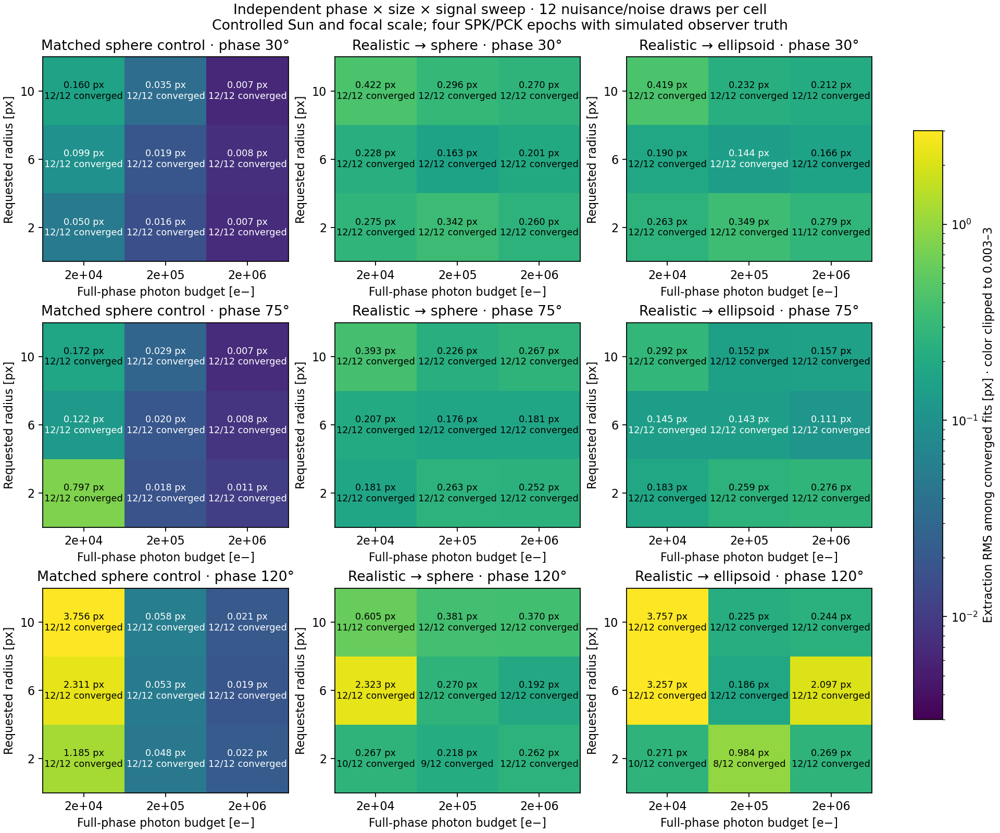
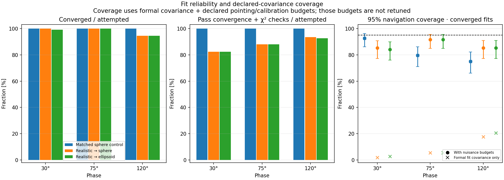
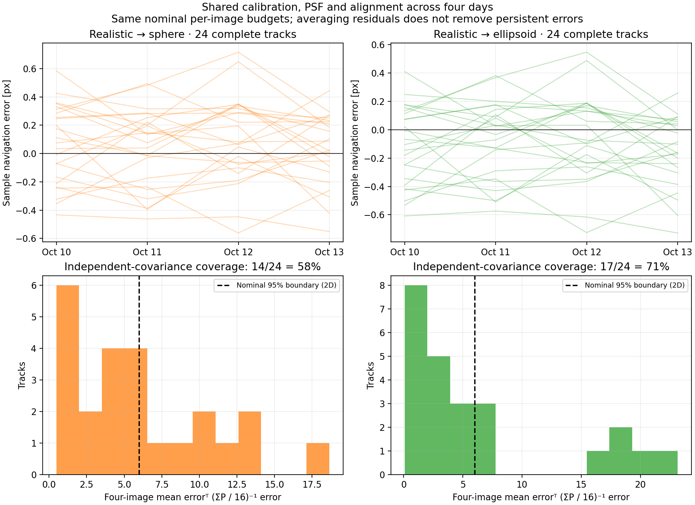
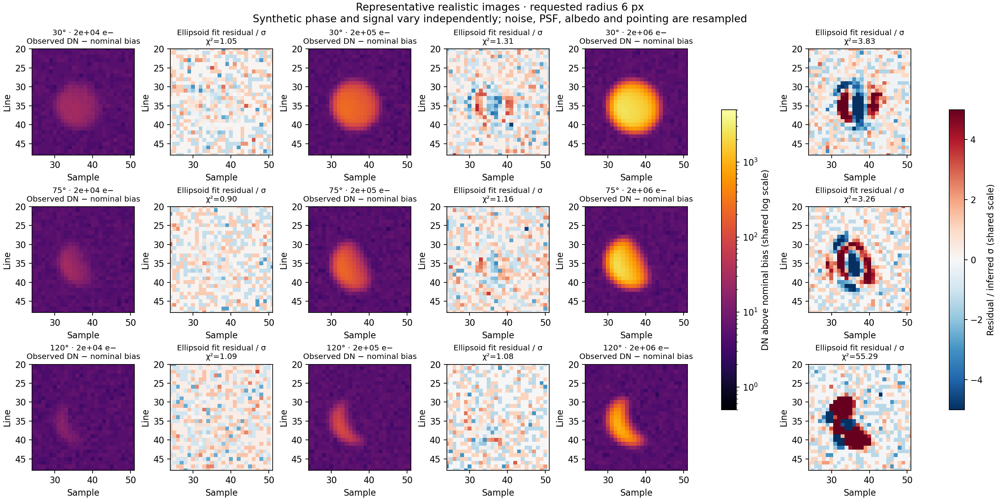

# Phase, size, signal and nuisance validation

The subsequent [rejection-layer experiment](REJECTION.md) evaluates explicit
quality gates on these same fits and on independent nuisance/noise draws.

This extends the [C++ realism experiment](CPP_ESTIMATION.md) without changing
the `BodyEstimator(renderer, calibration, options).fit(image)` API or adding EKF
updates. All fits initialize from the observed pixels, rather than true centers,
sizes, phase or illumination angles.

## Two complementary experiments

**Independent grid:** 27 cells combine phase **30°, 75°, 120°**, requested
mean-radius scale **2, 6, 10 px**, and full-phase Lambert-equivalent photon budgets
**20,000, 200,000, 2,000,000 e−**. Each cell has 12 independent detector/nuisance
draws, distributed evenly over **10–13 October 2004, 00:00 UTC**. This is 324
scene configurations. Each produces a matched sphere control and a realistic
ellipsoid image. The latter is fitted with both a sphere and an ellipsoid:
**972 fitting attempts** on **648 generated noisy images**.

The grid deliberately uses a synthetic Sun direction to control phase and adjusts
nominal focal length to control apparent size. It is an imaging sensitivity
experiment, not a physical sequence from a single fixed Cassini camera.
Expected counts vary with phase; the full-phase budget is not the actual detected
source total. The CSV reports both. The grid changes body orientation using PCK
at the retarded epoch and changes image-plane illumination angle with date.

**Shared-error sequences:** 24 independent camera/nuisance realizations each
produce four images, one per day on the same four dates. These use the SPK Sun,
a fixed 2003.44 mm focal length and 0.012 mm pixel pitch. Calibration, static
alignment, PSF and surface law stay shared within each four-image sequence.
Independent per-image pointing and jitter remain. There are **96 additional
images and 192 sphere/ellipsoid fitting attempts**.
The 200,000 e− full-phase budget remains a declared per-exposure count; this
sequence does not enforce a fixed physical radiance with inverse-square range
scaling.

Both experiments use the same retained `SavedSimulation` spacecraft truth as the
radio example, not Cassini SPK observer states. SPK supplies target/Sun geometry.
Pointing is declared from each reference bearing, offset about (+6,+4) px, and
frozen for navigation prediction. There is no orbit estimation in this test.

## Declared synthetic distributions

| Quantity | Truth distribution | Estimator |
|---|---|---|
| Principal point | Independent axes, Gaussian σ=0.10 px | Nominal value, 0.01 I px² budget |
| Relative focal scale | Gaussian σ=0.0005 | Nominal value, same declared σ |
| Radial distortion K1 | Gaussian σ=30,000 in normalized coordinates | Nominal pinhole; no distortion-error allowance |
| PSF sigmas | 0.8 exp(w±e) px; w~N(0,0.04²), e~N(0,0.08²) | Circular Gaussian σ=0.8 px |
| Albedo modulation | Uniform 0.03–0.20, body-fixed pattern | Uniform surface |
| Lommel–Seeliger mixture | Uniform 0.05–0.25 with Lambert remainder | Lambert |
| Grid pointing | Independent sample/line Gaussian σ=0.25 px equivalent | Nominal recorded attitude, 0.25 px-equivalent σ |
| Sequence pointing | Shared σ=0.20 px plus independent σ=0.15 px per axis | Same marginal 0.25 px-equivalent σ; no cross-image covariance |
| Jitter | Sinusoid, period 0.15 s, amplitude abs(N(0,0.08²)) px | Unmodeled |
| Detector gain | 10 exp(N(0,0.01²)) e−/DN | 10 e−/DN |
| Read noise | 3 exp(N(0,0.10²)) e− | 3 e− |
| Bias | 100 + N(0,0.10²) DN | 100 DN |

Truth adds Poisson source/background noise, read noise and integer digitization.
Background is 50 e−/pixel. The detector clips at **65535 DN** to avoid conflating
this signal sweep with the previous 12-bit saturation experiment; clipping is
still masked and counted. Controls use exact nominal detector/camera values and
a uniform Lambert sphere. Covariance budgets are declared before the run and
are not fitted to the measured errors. All perturbations are illustrative,
not flight-calibrated Cassini distributions.

The full nuisance/detector seed is 20261017; image detector seeds are 800000 plus
scene index. Grid nuisance draws are independent between scenes. Within a
sequence, gain/read/bias, calibration, surface law and PSF are also shared.

## Numerical and statistical checks

Truth uses five exposure samples over 60 ms, eightfold subpixel sampling and
elliptical PSF convolution. The fitting renderer uses order-24 quadrature and a
midpoint scene. On independent noiseless representative images, `resolution.csv`
compares quadrature orders 24/40, truth sampling 8/16, and midpoint/three-sample
linear exposure integration. This separates numerical sensitivity from random
detector and nuisance effects. It is a targeted convergence check, not a global
bound for every scene.

The renderer now accumulates only eight-sigma Gaussian footprints rather than
dense products dominated by zeros. The omitted 1D probability is below 2e−15.
On the first pilot scene, optimized and original centers agree within 3.3e−12 px;
analytic sphere/ellipsoid/exposure derivative and recovery tests also pass.

Every fitting attempt is retained, including nonconvergence, singularity,
no-signal and χ² rejection. Accuracy and confidence coverage use converged
results; convergence/acceptance counts and covered-and-converged fractions over
**all attempts** are separately exported. A converged fit can fail the χ² check;
χ² acceptance does not certify center accuracy.

The nominal 95% boundary is the 2D Mahalanobis squared error ≤5.99146. Formal
covariance is evaluated against extraction error, and also against the nominal
navigation discrepancy for comparison. Effective covariance additionally includes
the unchanged declared pointing/calibration budgets. Small-cell Wilson intervals
are descriptive binomial approximations. Twelve samples per cell cannot establish
95% coverage precisely, and aggregate coverage can hide a poor subset.

For each complete sequence, the mean of the four pixel residuals is compared
with the naive independent covariance `sum(P_i)/16`. This is an uncertainty
diagnostic, **not an EKF or orbit solution**. The exported cross-day correlations,
empirical covariance of track means, and normalized mean errors expose persistent
errors that independent per-image covariance cannot represent. Incomplete
sequences remain counted and are excluded explicitly from this mean-error test.

## Recorded results

The run completed **744 noisy observation images and 1,164 fitting attempts**:
648 grid images / 972 fits, plus 96 sequence images / 192 fits. Six additional
fine-resolution renders and 24 noiseless fits support the numerical checks.
These are controlled synthetic results, not measured flight accuracy.

| Grid model | Converged / attempted | Pass fit checks | Median extraction error | Extraction RMS | 95% navigation coverage |
|---|---:|---:|---:|---:|---:|
| Matched sphere control | 324/324 | 324/324 | 0.0255 px | 0.8941 px | 82.4% |
| Realistic truth → sphere | 318/324 | 285/324 | 0.2157 px | 0.5339 px | 87.4% |
| Realistic truth → ellipsoid | 317/324 | 284/324 | 0.1689 px | 1.0838 px | 87.1% |

Median/RMS/coverage use converged fits, including converged fits that fail χ².
Navigation coverage includes declared pointing/calibration budgets. The accepted
ellipsoid subset has 88.4% coverage and 1.0571 px extraction RMS. The RMS values
are dominated by rare poor solutions, and cannot be replaced by the much smaller
median when assessing reliability. The realistic sphere/ellipsoid fits share
the same noisy image; the matched controls use their own nominal sphere images.

**Weak crescent fits can converge to the wrong solution and still pass χ².**
Six matched-control fits and four accepted realistic ellipsoid fits have >1 px
extraction error. At 120°, radius 10 px and the lowest photon budget, matched
control scene 299 misses by **12.9534 px** with reduced χ²=1.1585. Scene 257,
at radius 6 px, misses by **7.9500 px** with reduced χ²=1.2167.

Explicit replay diagnostics use a truth-based initial guess to test whether a
better basin exists. This is **not a production initialization or a replacement
validation result**. It also centers the fitting window on that guess; both final
solutions are therefore compared afterward on an identical 37×37 pixel window.

| Matched control | Automatic error | Diagnostic seeded error | Common-window χ², automatic → diagnostic |
|---|---:|---:|---:|
| Scene 299 | 12.9534 px | 0.4112 px | 1.1177 → 0.9770 |
| Scene 257 | 7.9500 px | 0.1773 px | 1.1922 → 1.0599 |

The lower common-window residuals establish that initialization/window selection
contributes to these failures; model mismatch alone cannot explain them.
The current two-start strategy and convergence/χ² checks are insufficient in
weakly resolved or faint crescent scenes. A larger geometric search or an
independent navigation-based initial guess, plus stronger geometry/detection
quality checks, should be tested before automatic EKF use. Neither truth-based
initialization nor enlarged uncertainty was substituted into the reported sweep.

**Persistent errors invalidate independent-image averaging.** All 24 four-image
sequences converge and pass checks for both models. For ellipsoid fits, the mean
error covariance is **3.07×** the naive independent prediction in trace; average
cross-day sample/line correlations are **0.585/0.729**. Nominal 95% coverage of the
four-image mean is **17/24 = 70.8%** (descriptive interval 50.8–85.1%). Sphere fits
cover 14/24 = 58.3%. This diagnostic supports retaining calibration/alignment as
shared nuisance parameters or cross-image covariance in the future filter.

**Numerical sensitivity matters at high precision.** In the targeted noiseless
checks, quadrature-order changes move matched centers by at most 0.00036 px,
and realistic ellipsoid centers by up to 0.00561 px. Increasing truth sampling
8×→16× moves a matched 120° center by **0.02328 px**. Midpoint versus integrated
nominal motion changes centers by at most **0.00000376 px**. The midpoint
approximation is adequate for these checks; rendering/quadrature convergence
still limits some bright crescent cases. These numbers are sensitivities, not
certified global error bounds.









## Plots and reproduction

```sh
cmake --build build-clang --target cassini_optical_validation_sweep -j4
./build-clang/cassini_optical_validation_sweep --draws 12 --tracks 24
python3 scripts/plot_optical_validation_sweep.py
```

Requires the existing local kernels and saved radio truth trajectory. No new
dependencies are required. The executable accepts `--output DIR`, `--draws`,
`--tracks` and `--subpixels`. The plotter accepts an optional output directory.
The numerical estimator API and production uncertainty defaults remain unchanged.

Replay the difficult cases separately (default replay output does not overwrite
the main sweep):

```sh
./build-clang/cassini_optical_validation_sweep --scene 299
./build-clang/cassini_optical_validation_sweep --scene 257
```

Use the same `--draws` and `--tracks` values as the original run: scene IDs and
nuisance streams depend on the experiment dimensions. The replay directory
contains baseline `observations.csv`, an explicitly labelled `replay.csv` and
pixel arrays. Truth-seeded diagnostics are confined to replay mode.

Outputs in `results/cassini_synthetic_optical/validation/`:

- `observations.csv`: all fits, epochs, actual phase/size/counts, errors, covariance,
  convergence, acceptance, clipping and nominal exposure motion.
- `nuisances.csv`: the realized perturbations for every scene.
- `resolution.csv`: noiseless numerical and exposure-approximation checks.
- `scene_*.csv`: nine representative image/model/residual arrays.
- `config.json` and `metrics.json`: experiment definition, overall and cell metrics,
  sequence diagnostics, confidence intervals, and input/kernel/source hashes.
- Four plots: accuracy grid, reliability/coverage, shared-error sequences and
  representative images, all produced by
  [plot_optical_validation_sweep.py](../../scripts/plot_optical_validation_sweep.py).
