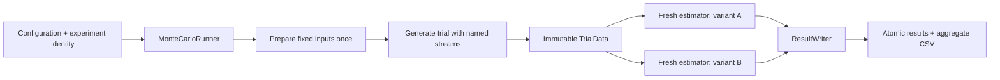

# Reusable Monte Carlo experiments

`deepnav_monte_carlo` is a C++23 library with no SPICE, Eigen, filter, observation,
or mission dependency. Its public interface is
`include/simulation/monte_carlo/MonteCarlo.hpp`. The Cassini implementation lives
under `benchmarks/cassini_two_way_wls`, outside the generic library.

## Interfaces

| Type | Responsibility |
|---|---|
| `MonteCarloConfig` | Trial count, seed, variant names, output, resume, failure and diagnostic policies |
| `TrialContext` | Trial ID, output directory, diagnostic flag and named deterministic random streams |
| `MonteCarloExperiment<TrialData>` | Experiment-owned preparation, typed trial generation and variant execution |
| `TrialResult` | Status, named metrics with units, optional parameter estimates/covariance and artifact paths |
| `MonteCarloRunner` | Sequential orchestration, pairing, failure recording and resume |
| `ResultWriter` | Manifest, atomic result commits, deserialization and aggregate CSV |
| `RunSummary` | Executed/resumed and successful/nonconverged/failed variant counts |

An experiment implements:

```cpp
std::string identity() const override;
void prepare() override;
TrialData generateTrial(const TrialContext&) override;
TrialResult runVariant(const TrialContext&, const TrialData&,
                       const std::string& variant) override;
```

Choose your own `TrialData`: it can hold measurements, truth parameters, shared
immutable prepared data, or paths to generated inputs. The runner prepares once
when work is pending and generates one trial payload for all its variants.
Variants receive a const reference and must construct fresh estimator state.
They must not mutate shared input files or retain estimator state between calls.



`identity()` must include the experiment configuration and fingerprints of inputs
and implementation. It is evaluated before preparation. Noise models, prior
distributions, numerical settings and truth-generation choices belong to the
experiment, not to the generic runner.

## Configuration

Defaults: three trials, master seed 2026, continue after variant failures,
selected diagnostics for trial 0, resume disabled. Variant names and output
directory are required. Variant names are restricted to letters, digits,
underscore and hyphen; duplicate names are rejected.

`DetailLevel` is `Metrics`, `Selected`, or `Full`. `Selected` uses
`diagnosticTrialIds`. The runner passes a retention flag; the experiment chooses
which diagnostic artifacts are useful. Compact estimates/covariance and failure
records are independent of that flag.

This version runs sequentially. There is no thread pool or worker-count option
that silently does nothing. The interface permits a later process dispatcher.
The Cassini adapter already isolates each fit in a fresh POSIX process and is
built on macOS/Linux; the generic library is portable standard C++.

## Reproducibility and resume

`context.randomStream("sensor.white")` returns a fresh `std::mt19937_64` seeded
from master seed, trial ID and stream name. Requesting or consuming another
stream does not affect it. Retain each returned engine while drawing samples:
requesting it again intentionally restarts its sequence. Seed derivation uses
specified integer operations, never `std::hash` or execution order.
`std::normal_distribution` is not required to produce identical transforms
across standard-library implementations; archive the executable/configuration
when reproducing an experiment on another platform.

The exact canonical configuration and experiment identity are saved in
`manifest.txt`. Resume requires an exact match, including trial count, variant
order, retention/failure settings and input fingerprints. To change these,
start a new study. A non-resume run never overwrites an existing study.

Each variant writes `result.txt.partial` then renames it to `result.txt`.
Only complete, parseable records are skipped on resume. An interrupted variant
is regenerated from its original streams; already completed siblings are kept.
Recorded nonconvergence/failure is a completed outcome and is not automatically
retried. Setup/preparation errors stop the study; generation errors are recorded
for every pending variant of that trial. Estimation errors are recorded per
variant. Stop-on-failure persists the current outcome and aggregate before
throwing. Failure records stay in the aggregate denominator.

`metrics.csv` uses long format:
`trial_id,variant,status,metric,value,unit,message`. Parameter names, units,
truth/estimates and optional row-major covariance are stored in `result.txt`.
Covariance uses the same order and units as the parameter vector. Readers can
use `ResultWriter::read()` instead of parsing this versioned record format.

## Cassini adapter

`CassiniWlsExperiment` prepares fixed visibility-qualified geometry and noiseless
range, counted-Doppler and VLBI observations once using the C++ baseline's
`--generate-only` mode. It checks fingerprints before reusing the prepared
cache. Each trial adds noise in C++ using independent named streams:
`range.white`, `range.pass_bias`, `doppler`, `vlbi`. Seeds are saved in
`trial_N/observations/streams.txt`.

Both variants import exactly the same radio observations through
`--observation-input`; only `with_vlbi` includes the VLBI rows. The adapter checks
their radio exports for equality. Each fit still propagates its own orbit/STM
and performs the existing force and numerical checks. Preparation caches geometry
and noiseless observations, not mutable propagation/filter state.

The arc starts on 9 October 2004 and uses the retained 3,220 kg dynamics, original
priors and convergence settings. Options expose whole-day duration, VLBI count,
range independent/shared-bias sigma, Doppler/VLBI sigma, initial-guess scale and
maximum iterations. This adapter implements **fixed simulated truth with repeated
measurement noise**; it does not yet draw truth from a prior distribution.

The manifest fingerprints the baseline executable, source files, saved truth and
kernel files using FNV-1a for accidental-change detection. These are not
cryptographic integrity guarantees. The fit's legacy generator-seed fields are
null for imported observations; the named stream seed file records the actual
Monte Carlo seeds.

Results retain eight parameter estimates and full covariance, initial parameter
NEES, and daily/final six-state error/covariance samples in
`epoch_error_covariance.csv`. Position units are meters and velocity units are
mm/s, including the corresponding mixed covariance units. NEES is computed with
a scaled Cholesky solve. The mean epoch NEES is descriptive: epochs are correlated
and must not be treated as independent trials. Fixed truth with an offset prior
does not imply unconditional Bayesian chi-square coverage.

Full diagnostics retain trajectories, residuals, iteration records and schedules.
Compact mode retains estimates, covariance, epoch diagnostics, radio inputs,
summary and logs. Per-trial generated input files remain available for replay.

```sh
cmake --build build-clang --target cassini_monte_carlo test_monte_carlo -j 4
ctest --test-dir build-clang -R '^test_monte_carlo$' --output-on-failure

# Architecture smoke study: three one-day realizations, four VLBI points each.
build-clang/cassini_monte_carlo --trials 3 --days 1 --vlbi-count 4 --detail full --output results/cassini_two_way_wls/monte_carlo_smoke
# Same options, resume; completed fits must not run again.
build-clang/cassini_monte_carlo --trials 3 --days 1 --vlbi-count 4 --detail full --output results/cassini_two_way_wls/monte_carlo_smoke --resume

# Full experiment, launched separately after reviewing the smoke results.
build-clang/cassini_monte_carlo --trials 100 --days 14 --vlbi-count 60 --output results/cassini_two_way_wls/monte_carlo_100
```

Python may analyze these C++ exports and generate plots; it does not generate
observations, propagate dynamics or estimate states.
